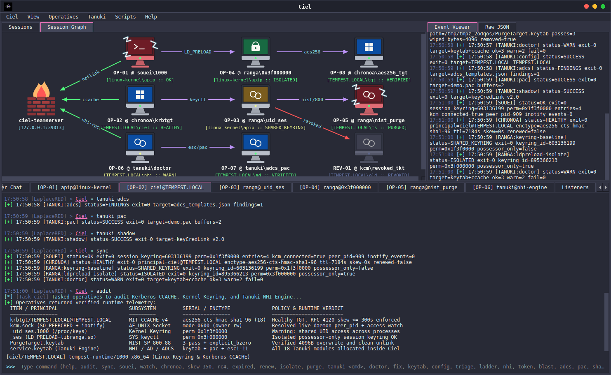
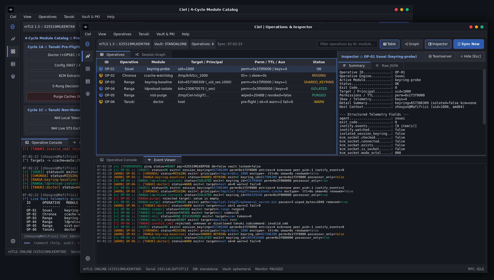

<h1 align="center">
<br>

<br>
Ciel
</h1>

<p align="center">
  <i>Ciel is a native desktop command and control console for the Tanuki and Tempest identity runtime ecosystem.</i>
</p>

<br>

<p align="center">
  
</p>

<br>

<p align="center">
  
</p>

---

## Overview

**Ciel** separates runtime sensing from operator control. Rather than embedding browser shells or web frameworks, the console runs as a compiled **C++20 Qt6 Widgets** desktop client connected over local TCP JSON to a lightweight **Go** teamserver (`ciel-teamserver`). The teamserver dispatches compiled C11/C++20 **[Tempest](https://github.com/Mafifrizi/tempest)** operatives against active Linux Kerberos caches, UNIX sockets, and kernel session keyrings, feeding real-time structured state back into the desktop UI.

- **Zero Browser Overhead**: Native Qt6 `QMainWindow`, `QSplitter`, `QTableWidget`, `QGraphicsView`, and `QTextEdit` panels styled in dark slate and violet accents with 9pt monospace typography.
- **Zero External Go Teamserver Dependencies**: `teamserver/main.go` uses only the Go standard library to manage `krb5cc_ciel`, `kcm.sock`, `PurgeTarget.keytab`, and operative process execution.
- **Real Kernel & Protocol Telemetry**: Every action displayed in the GUI executes live binaries (`souei`, `chronoa`, `ranga`, `libranga.so`) with semantic exit codes `0..4`.

---

## UI & UX Architecture

### 1. Session Topology Graph (`Session Graph` Tab)
Interactive 4-column `QGraphicsScene` canvas rendered via `CielGraphNode` and `CielGraphEdge` vector painters on `#282a36`:
- **Column 0 (Teamserver Hub)**: Root terracotta firewall hub representing `ciel-teamserver` (`127.0.0.1:40056`).
- **Column 1 (Primary Daemons)**: Active telemetry monitors (`OP-01` `Souei`, `OP-02` `Chronoa`, `OP-03` `Ranga` baseline) with green callback arrows pointing back into the Teamserver Hub (`netlink`, `ccache`, `keyctl`).
- **Column 2 & 3 (Derived Boundaries & Leaf Targets)**: Runtime isolation (`OP-04` emerald padlock `0x3f000000`), elevated-alert triple-lightning purge monitors (`OP-05`, `OP-08`), verified TGT targets (`OP-07`), and muted grayscale revoked ticket nodes (`OP-06` `kcm\revoked_tkt`).
- All nodes support free dragging (`ItemIsMovable`) with real-time directional arrow and midpoint protocol label recalculation.

### 2. 10-Column Session Matrix (`Sessions` Tab)
Flat, borderless operator table aligned across `ID`, `External`, `Internal`, `User`, `Computer`, `OS`, `Process`, `PID`, `Perm / TTL`, and `Health`. Selecting any row updates the `Raw JSON` telemetry pane, and right-clicking opens quick actions to inspect keyrings, simulate policy violations, isolate sessions, or purge files.

### 3. Event Viewer & Raw JSON Inspector
- **`Event Viewer`**: Timestamped HTML log stream tagging `[+]` healthy actions, `[*]` informational notices, and `[!]` policy stops (`CLOCK_SKEW_VIOLATION`, `WEAK_ENCTYPE`).
- **`Raw JSON`**: Indented JSON payload returned verbatim by the dispatched Tempest operative.

### 4. Multi-Tab Operative Console & Listeners
- Bottom tab workspace hosting `Teamserver Chat`, context tabs `[OP-01]`..`[OP-05]`, the active `[OP-02] ciel@TEMPEST.LOCAL` console with autocomplete `>>>` input, and the `Listeners` overview with one-click dispatch buttons.

---

## Ecosystem Integration

```text
[ Tanuki CLI ]  --->  [ Tempest (C11/C++20) ]  --->  [ Ciel Teamserver (Go) ]  --->  [ Ciel Client (Qt6) ]
  AD/Kerberos           souei, chronoa, ranga          TCP JSON + AF_UNIX kcm.sock     Sessions, Graph,
  workflows             + libranga.so                  + CCACHE v4 demo artifacts      Events & Console
```

| Exit Code | Meaning | How Ciel Surfacing Works |
| --- | --- | --- |
| `0` | `OK` / `HEALTHY` / `ISOLATED` / `RENEWED` / `PURGED` | Green node edges, `#50fa7b` status cells, `[+]` console and Event Viewer entries |
| `1` | Usage / Invalid RPC Request | CLI usage help or `[!]` red JSON parse alert |
| `2` | `POLICY_STOP` (`CLOCK_SKEW_VIOLATION`, `WEAK_ENCTYPE`, `EXPIRED`) | Red `[!]` alert banner in console and Event Viewer, elevated monitor alert visuals |
| `3` | `MISSING` (Missing CCACHE, socket, or purge path) | `MISSING` status tag with diagnostic message |
| `4` | `PARSE_ERROR` (Corrupt or unsupported CCACHE header) | `PARSE_ERROR` tag with raw stderr telemetry |

---

## Operative Console Commands

Type any command directly at the `>>>` prompt inside the `[OP-02] ciel@TEMPEST.LOCAL` tab (Tab autocomplete enabled):

| Command | Arguments | Description |
| --- | --- | --- |
| `sync` | none | Run `full_sync` across `Souei`, `Chronoa`, `Ranga` baseline, and `Ranga` isolated |
| `audit` | none | Print aligned Kerberos CCACHE and Linux Kernel Keyring verification matrix |
| `souei` | none | Probe `/proc/keys` ACLs and resolve `kcm.sock` peer via `SO_PEERCRED` |
| `chronoa` | none | Inspect active MIT CCACHE v4 lifetime, principal, and encryption type |
| `skew` | `<sec>` | Simulate KDC clock drift (`350` triggers RFC 4120 `300s` policy stop `exit=2`) |
| `rc4` | none | Generate `rc4-hmac` (`enctype=23`) ticket to trigger `WEAK_ENCTYPE` policy stop |
| `renew` | none | Invoke `chronoa --renew-cmd` to refresh ticket lifetime to `+7200s` (`aes256`) |
| `isolate` | none | Launch workload under `LD_PRELOAD=libranga.so` and verify `0x3f000000` keyring |
| `purge` | none | Execute 3-pass NIST SP 800-88 overwrite + `explicit_bzero` + `unlink` |
| `graph` / `table` | none | Switch top-left viewport between `Session Graph` and `Sessions` table |
| `clear` / `help` | none | Reset console output with operative banner or display aligned command reference |

---

## Building & Running

### Prerequisites (Linux / WSL2 Ubuntu)
1. Built **[Tempest](https://github.com/Mafifrizi/tempest)** binaries (`souei`, `chronoa`, `ranga`, `libranga.so`) available under `TEMPEST_BIN_DIR` (defaults to `/mnt/c/Users/Ely/.gemini/antigravity/scratch/tempest/bin`).
2. Toolchain packages:
   ```bash
   sudo apt-get update && sudo apt-get install -y golang-go qt6-base-dev cmake pkg-config fonts-dejavu-core python3-pil
   ```

### Build & Automated Verification
```bash
make clean && make
make test
```

### Launch Live Desktop Session
Terminal 1 (Start Go Teamserver):
```bash
./bin/ciel-teamserver --addr 127.0.0.1:40056 --tempest-dir /path/to/tempest/bin
```

Terminal 2 (Start Native Qt6 Client via X11 / Wayland / WSLg):
```bash
./bin/ciel-client --addr 127.0.0.1:40056
```

Automated headless verification and showcase rendering:
```bash
QT_QPA_PLATFORM=offscreen ./bin/ciel-client --addr 127.0.0.1:40056 --self-test --screenshot table.png --graph-screenshot graph.png
```
